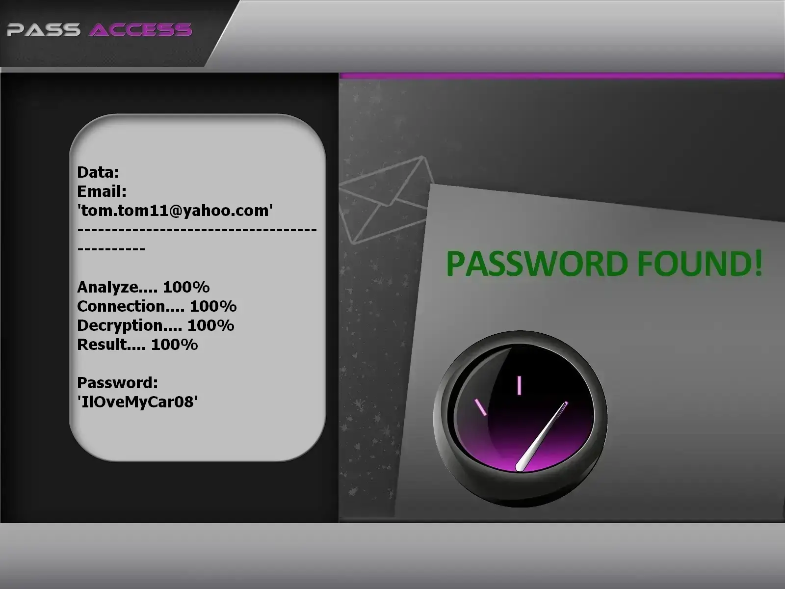

# 🔐 Pirater un Compte Yahoo 2026 — Outil Hacker & Cracker IA | Usage Éducatif

**Auditeur de credentials Yahoo propulsé par le machine learning — formation, recherche, comptes autorisés uniquement.**


> **Mots-clés :** pirater Yahoo, hacker compte Yahoo, cracker mot de passe email, piratage IA, hacking éthique, audit sécurité Yahoo, cybersécurité 2026

---

## ⚠️ AVIS JURIDIQUE — LECTURE OBLIGATOIRE

**Ce dépôt GitHub est réservé à la FORMATION, la RECHERCHE et les TESTS DE SÉCURITÉ AUTORISÉS.**

Tenter de **pirater**, **cracker** ou **hacker** une boîte Yahoo dont vous n'êtes pas propriétaire — sans mandat écrit — constitue une **infraction pénale**. En exécutant ce logiciel, vous acceptez un cadre d'usage strictement légal.

- 🚫 **Usage interdit** : Cibler des comptes Yahoo tiers sans permission est illégal
- ✅ **Autorisation requise** : Testez uniquement vos adresses mail ou des labos couverts par un audit signé
- 🔐 **Finalité éducative** : Illustrer les failles de credentials et promouvoir l'authentification forte
- ⚖️ **Responsabilité** : Vous êtes seul responsable du respect des lois en vigueur

**Conçu avec l'API PASS REVELATOR — remerciements à leur équipe.** Pour approfondir la protection des comptes Yahoo et les risques de **piratage de mots de passe**, consultez :  
**[https://www.passwordrevelator.net/fr/passaccess](https://www.passwordrevelator.net/fr/passaccess)**



---

## 🧭 De quoi s'agit-il ?

Le **Testeur de Sécurité Yahoo IA** est un framework Python qui montre comment les **crackers** modernes combinent machine learning et stratégies classiques — et comment un **hacker éthique** exploite ces mêmes données pour renforcer les défenses.

Aucun flux ne vise des boîtes mail aléatoires : simulation, rapport et sensibilisation sur des comptes que vous contrôlez.

---

## 🎓 Compétences développées

| Objectif | Résultat attendu |
| -------- | ---------------- |
| **Cracking** assisté par IA | Observer chaînes de Markov, LSTM et RL en contexte labo |
| Sensibilisation aux mots faibles | Comprendre pourquoi les passphrases prévisibles échouent |
| Formation pro | Fournir un playbook d'audit reproductible aux équipes sécurité |
| Recherche défensive | Étudier les contre-mesures face aux attaques automatisées |
| Politiques robustes | Justifier des règles strictes avec des métriques live |

---

## ✨ Modules intégrés

### 🤖 Moteur d'intelligence artificielle

| Composant | Rôle |
| --------- | ---- |
| **Chaînes de Markov** | Génère des candidats statistiquement probables |
| **Réseaux LSTM** | Prédit des séquences à partir de fuites connues |
| **Apprentissage par renforcement** | Adapte la stratégie selon le retour live |
| **Détection de motifs** | Repère habitudes récurrentes (dates, noms, clavier) |

### 🌐 Couche d'anonymat

- Support complet du réseau **Tor**
- Rotation intelligente de pool de proxys
- Délais aléatoires entre requêtes
- Gestion avancée des sessions et cookies

### 📊 Analyse & rapports

- Compteurs de tentatives en temps réel
- Métriques de débit et taux de succès
- Export JSON structuré
- Journalisation verbeuse des opérations

### ⚡ Performance

- Architecture async pour forte concurrence
- Génération de candidats économe en mémoire
- Pools de workers multi-threads
- Requêtes HTTP optimisées par batch

---

## 🚀 Installation

### Prérequis

- Python **3.8+**
- Gestionnaire `pip`
- Connexion Internet stable
- Compte Yahoo **de test dont vous êtes titulaire**

### Étape 1 — Cloner le dépôt

```bash
git clone https://github.com/HoffmannAlex/Hack-Yahoo-Account-with-AI.git
cd yahoo-security-tool
```

### Étape 2 — Environnement virtuel (recommandé)

```bash
python -m venv venv
source venv/bin/activate          # Linux / macOS
# OU
.\venv\Scripts\activate           # Windows
```

### Étape 3 — Installer les dépendances

```bash
pip install -r requirements.txt
```

**Bibliothèques principales :**

- `aiohttp>=3.9.1`
- `requests>=2.31.0`
- `cryptography>=42.0.5`
- `psutil>=5.9.8`
- `python-dotenv>=1.0.1`
- `msal>=1.24.1`
- `markovify>=0.9.4`
- `numpy>=1.24.3`
- `python-jose>=3.3.0`

### Étape 4 — Configuration initiale

1. Copiez le fichier exemple :

```bash
cp config.example.json config.json
```

2. Adaptez `config.json` à votre labo :

```json
{
    "max_attempts": 1000,
    "delay_range": [1.0, 3.0],
    "timeout": 3600,
    "results_file": "security_results.json",
    "proxy_file": "proxies.txt",
    "use_tor": false,
    "verbose": false
}
```

### Étape 5 — Vérifier l'installation

```bash
python hack_yahoo.py --help
```

---

## ⚡ Démarrage rapide (comptes autorisés uniquement)

**Exécution standard**

```bash
python hack_yahoo.py --username utilisateur@yahoo.com
python hack_yahoo.py --username utilisateur@yahoo.com --config config_perso.json
```

**Session labo anonyme**

```bash
python hack_yahoo.py --username utilisateur@yahoo.com --use-tor
python hack_yahoo.py --username utilisateur@yahoo.com --proxy-list proxies.txt
```

**Réglage des performances**

```bash
python hack_yahoo.py --username utilisateur@yahoo.com --max-attempts 500
python hack_yahoo.py --username utilisateur@yahoo.com --min-delay 2.0 --max-delay 5.0
python hack_yahoo.py --username utilisateur@yahoo.com --verbose
```

**Gestion des résultats**

```bash
python hack_yahoo.py --username utilisateur@yahoo.com --output resultats/audit_2026.json
python hack_yahoo.py --resume resultats/audit_2026.json
```

> ⚠️ Remplacez `utilisateur@yahoo.com` par une adresse **que vous possédez**.

---

## 📝 Configuration avancée

### Exemple complet `config.json`

```json
{
    "max_attempts": 1000,
    "delay_range": [1.0, 3.0],
    "timeout": 3600,
    "results_file": "security_results.json",
    "proxy_file": "proxies.txt",
    "use_tor": false,
    "tor_port": 9050,
    "tor_control_port": 9051,
    "tor_password": "votre_mot_de_passe_tor",
    "user_agents": [
        "Mozilla/5.0 (Windows NT 10.0; Win64; x64) AppleWebKit/537.36 (KHTML, like Gecko) Chrome/91.0.4472.124 Safari/537.36",
        "Mozilla/5.0 (Windows NT 10.0; Win64; x64; rv:89.0) Gecko/20100101 Firefox/89.0"
    ],
    "log_level": "INFO",
    "log_file": "yahoo_security_test.log"
}
```

### Variables d'environnement

```bash
export YAHOO_USERNAME=utilisateur@yahoo.com
export YAHOO_MAX_ATTEMPTS=1000
export YAHOO_USE_TOR=true
python hack_yahoo.py
```

---

## ❓ FAQ — Pirater, hacker ou cracker Yahoo ?

**Hacker ou cracker — quelle différence ?**  
Le **hacker** étudie les systèmes pour les sécuriser. Le **cracker** vise l'intrusion sans mandat. Ce dépôt s'adresse au premier profil.

**Puis-je légalement pirater mon propre Yahoo ?**  
Oui — sur une boîte mail que vous avez créée ou un profil labo avec accord écrit. **Pirater** la messagerie d'un tiers est un délit.

**Comment l'IA aide-t-elle un cracker ?**  
Les modèles Markov et LSTM priorisent les candidats probables plus vite qu'une force brute aveugle — d'où l'intérêt d'auditer **vos propres** mots de passe en labo.

**Cet outil piratera-t-il n'importe quel Yahoo ?**  
Non. Mots de passe uniques robustes, 2FA et alertes de connexion bloquent la plupart des attaques classiques. L'objectif est la **prévention**.

---

## 🔧 Dépannage

| Problème | Solution |
| -------- | -------- |
| **Erreur de connexion** | Vérifier Internet ; config proxy ou Tor |
| **Limitation de débit** | Augmenter `--min-delay` / `--max-delay` ; essayer `--use-tor` |
| **Erreurs d'authentification** | Confirmer l'adresse mail et l'autorisation d'audit |

**Journal debug** (fichier par défaut : `yahoo_security_test.log`) :

```bash
python hack_yahoo.py --username utilisateur@yahoo.com --log-level DEBUG
```

---

## ⚖️ Cadre légal et éthique

1. **Autorisation** — Ne testez que des comptes dont vous êtes propriétaire ou mandaté par écrit
2. **Conformité** — Respectez les lois cybersécurité et protection des données de votre pays
3. **Responsabilité** — Vous assumez seul les conséquences d'un détournement
4. **Hygiène des données** — Ne stockez jamais de credentials en clair

En utilisant cet outil, vous reconnaissez que l'accès non autorisé est illégal, qu'une activité malveillante peut entraîner des poursuites, et que les résultats ne servent qu'à améliorer la sécurité des systèmes testés.

---

## 📜 Licence

Distribué sous licence **MIT**. Voir le fichier [LICENSE](LICENSE).

---

## 🙏 Remerciements

- Contributeurs du projet et mainteneurs open source
- Chercheurs en sécurité partageant des pratiques de divulgation responsable

## 🤝 Contribution

Issues et pull requests bienvenues sur GitHub.

## 📧 Contact

Ouvrez une issue pour toute question ou support.

> ⭐ Ajoutez une étoile au dépôt si ce framework vous a aidé !
